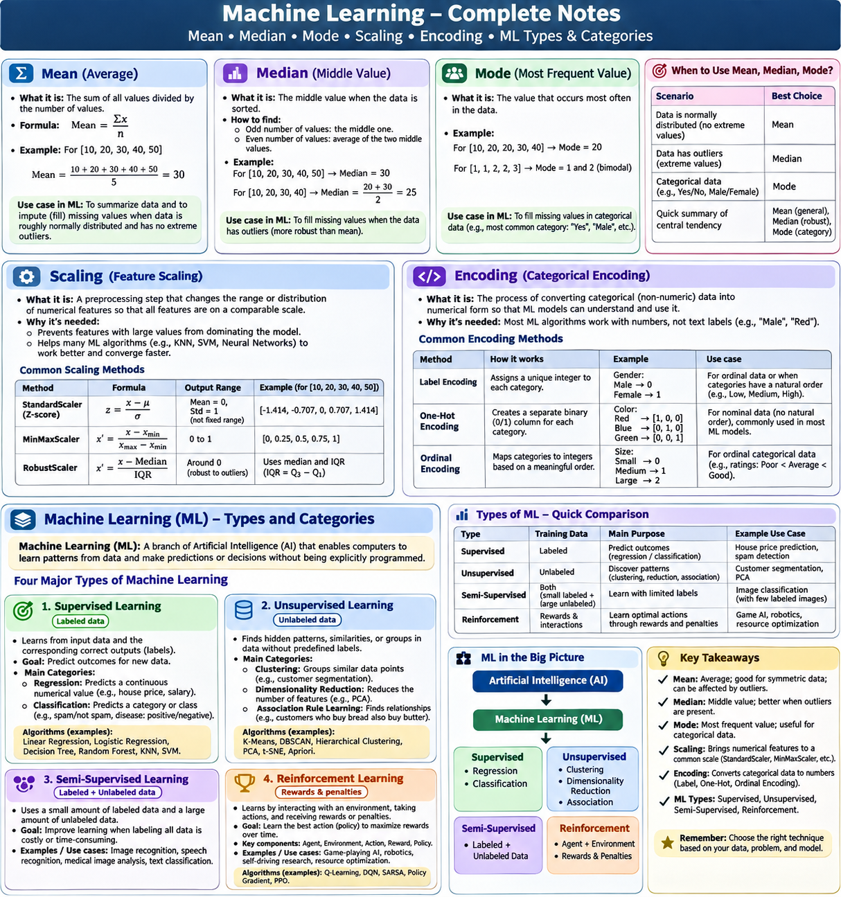

## Machine Learning 


# ML Model steps - Liner Regression

- Load & Inspect data (pands)
- Feature Engineering (pandas - convert date --> year/month/day)
- Handling Missing Values (sklearn)
- Encoding Categorical Columns
- Scalling Numrical Columns
- Train/Test Split
- Model Training (Liner Regression)
- Evaluation using MSE and RMSE

# Data Preprocessing Notes

## 1. Mean

### What is Mean?

Mean is the average of all numerical values in a dataset.

It is calculated by adding all values and dividing the sum by the total number of values.

### Formula

Mean = Sum of all values / Total number of values

### Example

Consider the following student marks:

```python
marks = [10, 20, 30, 40, 50]
```

Calculation:

Mean = (10 + 20 + 30 + 40 + 50) / 5

Mean = 150 / 5

Mean = 30

### Python Example

```python
import numpy as np

marks = [10, 20, 30, 40, 50]

result = np.mean(marks)

print(result)
```

Output:

```text
30.0
```

### Mean in Pandas

```python
import pandas as pd

data = {
    "Age": [20, 25, 30, 35, 40]
}

df = pd.DataFrame(data)

print(df["Age"].mean())
```

### When to Use Mean?

Mean is commonly used when:

- Working with numerical data.
- Data is approximately normally distributed.
- There are no significant outliers.
- Replacing missing numerical values.

### Real-World Use Cases

1. Student marks analysis.
2. Average employee salary analysis.
3. Average product sales.
4. Average customer spending.
5. Replacing missing numerical values in ML datasets.

### Mean for Handling Null Values

Suppose an employee salary dataset contains:

| Employee | Salary |
|---|---:|
| A | 20000 |
| B | 25000 |
| C | 30000 |
| D | NaN |
| E | 35000 |

Calculate the average salary using available values:

Mean = (20000 + 25000 + 30000 + 35000) / 4

Mean = 27500

The missing salary can be replaced with 27500.

```python
df["Salary"] = df["Salary"].fillna(df["Salary"].mean())
```

Note: Mean is sensitive to outliers. Avoid blindly using it when the dataset contains extreme values.

---

## 2. Median

### What is Median?

Median is the middle value in a dataset after arranging all values in ascending or descending order.

If the dataset contains an odd number of values, the middle value is the median.

If the dataset contains an even number of values, calculate the average of the two middle values.

### Formula

For an odd number of values:

Median = Middle value

For an even number of values:

Median = (First middle value + Second middle value) / 2

### Example 1: Odd Number of Values

```python
marks = [10, 20, 30, 40, 50]
```

The middle value is 30.

Median = 30

### Example 2: Even Number of Values

```python
marks = [10, 20, 30, 40]
```

The two middle values are 20 and 30.

Median = (20 + 30) / 2

Median = 25

### Python Example

```python
import numpy as np

marks = [10, 20, 30, 40]

result = np.median(marks)

print(result)
```

Output:

```text
25.0
```

### Median in Pandas

```python
import pandas as pd

data = {
    "Salary": [20000, 25000, 30000, 35000, 500000]
}

df = pd.DataFrame(data)

print(df["Salary"].median())
```

Output:

```text
30000.0
```

### When to Use Median?

Median is commonly used when:

- Working with numerical data.
- Data contains outliers.
- Data is skewed.
- Replacing missing numerical values.

### Real-World Use Cases

1. Employee salary analysis.
2. Property price analysis.
3. Medical cost analysis.
4. Household income analysis.
5. Handling missing numerical values in ML datasets.

### Why Median Is Better Than Mean for Outliers

Consider employee salaries:

```python
salary = [20000, 25000, 30000, 35000, 500000]
```

Mean = 122000

Median = 30000

The salary of 500000 is much higher than the other salaries.

It increases the mean significantly.

The median is less affected by extreme values.

Therefore, median is generally a better choice for this dataset.

---

## 3. Mode

### What is Mode?

Mode is the value that appears most frequently in a dataset.

Unlike mean and median, mode can be used with both numerical and categorical data.

### Example

```python
marks = [10, 20, 20, 30, 40, 20, 50]
```

Frequency:

| Value | Frequency |
|---|---:|
| 10 | 1 |
| 20 | 3 |
| 30 | 1 |
| 40 | 1 |
| 50 | 1 |

20 appears three times.

Therefore:

Mode = 20

### Python Example

```python
from scipy import stats

marks = [10, 20, 20, 30, 40, 20, 50]

result = stats.mode(marks, keepdims=False).mode

print(result)
```

Output:

```text
20
```

### Mode in Pandas

```python
import pandas as pd

data = {
    "Department": ["IT", "HR", "IT", "Sales", "IT", "HR"]
}

df = pd.DataFrame(data)

print(df["Department"].mode())
```

Output:

```text
0    IT
dtype: object
```

### When to Use Mode?

Mode is commonly used when:

- Working with categorical data.
- Finding the most frequently occurring value.
- Replacing missing categorical values.
- Analysing customer preferences.

### Real-World Use Cases

1. Most popular product category.
2. Most common customer location.
3. Most common employee department.
4. Most frequently purchased product.
5. Filling missing categorical values in ML datasets.

### Mode for Handling Null Values

Suppose you have a customer dataset:

| Customer | Department |
|---|---|
| A | IT |
| B | HR |
| C | IT |
| D | NaN |
| E | IT |
| F | HR |

IT appears three times.

Mode = IT

Replace the missing value with IT.

```python
df["Department"] = df["Department"].fillna(
    df["Department"].mode()[0]
)
```

Note: A dataset can have more than one mode if multiple values share the highest frequency.

---

## 4. Difference Between Mean, Median and Mode

| Concept | Meaning | Best Used For |
|---|---|---|
| Mean | Average value | Numerical data without significant outliers |
| Median | Middle value | Numerical data with outliers or skewness |
| Mode | Most frequent value | Categorical data and frequently occurring values |

### Example: All Three Together

Dataset:

```python
data = [10, 20, 20, 30, 40, 50, 100]
```

Mean:

270 / 7 = 38.57

Median:

30

Mode:

20

Python:

```python
import numpy as np
from scipy import stats

data = [10, 20, 20, 30, 40, 50, 100]

print("Mean:", np.mean(data))
print("Median:", np.median(data))
print("Mode:", stats.mode(data, keepdims=False).mode)
```

Output:

```text
Mean: 38.57
Median: 30.0
Mode: 20
```

---

# 5. Feature Scaling in Machine Learning

## What is Scaling?

Scaling, also called Feature Scaling, is the process of bringing numerical features into comparable ranges.

Some ML algorithms are sensitive to the numerical ranges of input features.

Scaling helps prevent features with larger numerical scales from dominating calculations simply because their values are larger.

### Why Do We Need Scaling?

Consider a house price prediction dataset:

| House | Size | Bedrooms |
|---|---:|---:|
| A | 1000 | 2 |
| B | 1500 | 3 |
| C | 2000 | 4 |
| D | 2500 | 5 |

Notice:

- Size ranges from 1000 to 2500.
- Bedrooms ranges from 2 to 5.

The numerical ranges are very different.

For distance-based algorithms such as KNN, the size feature could dominate distance calculations.

Scaling brings the features into comparable numerical ranges.

## Types of Scaling

There are two important scaling techniques.

### 5.1 Standardization – StandardScaler

Standardization transforms data so that:

- Mean becomes approximately 0.
- Standard deviation becomes approximately 1.

### Formula

Z = (X - Mean) / Standard Deviation

Where:

- X = Original value.
- Mean = Average of the feature.
- Standard Deviation = Spread of the feature.

### Python Example

```python
import numpy as np
from sklearn.preprocessing import StandardScaler

data = np.array([
    [10],
    [20],
    [30],
    [40],
    [50]
])

scaler = StandardScaler()

scaled_data = scaler.fit_transform(data)

print(scaled_data)
```

Output:

```text
[[-1.414]
 [-0.707]
 [ 0.   ]
 [ 0.707]
 [ 1.414]]
```

### When to Use StandardScaler?

- Logistic Regression.
- Linear Regression with regularization.
- Support Vector Machines (SVM).
- K-Nearest Neighbors (KNN).
- K-Means Clustering.
- Neural Networks.

StandardScaler is sensitive to outliers, so investigate extreme values before using it.

### 5.2 Normalization – MinMaxScaler

MinMaxScaler transforms numerical values into a specified range.

The default range is 0 to 1.

### Formula

X_scaled = (X - X_min) / (X_max - X_min)

Where:

- X = Original value.
- X_min = Minimum value.
- X_max = Maximum value.

### Example

Original data:

```python
data = [10, 20, 30, 40, 50]
```

Calculation for value 30:

X_scaled = (30 - 10) / (50 - 10)

X_scaled = 20 / 40

X_scaled = 0.5

### Python Example

```python
import numpy as np
from sklearn.preprocessing import MinMaxScaler

data = np.array([
    [10],
    [20],
    [30],
    [40],
    [50]
])

scaler = MinMaxScaler()

scaled_data = scaler.fit_transform(data)

print(scaled_data)
```

Output:

```text
[[0.  ]
 [0.25]
 [0.5 ]
 [0.75]
 [1.  ]]
```

### When to Use MinMaxScaler?

- Neural Networks.
- KNN.
- Algorithms that benefit from bounded input ranges.
- Features with known meaningful minimum and maximum values.

MinMaxScaler is also sensitive to outliers because extreme values determine the range.

## StandardScaler vs MinMaxScaler

| Feature | StandardScaler | MinMaxScaler |
|---|---|---|
| Technique | Standardization | Normalization |
| Mean | Approximately 0 | Not necessarily 0 |
| Standard Deviation | Approximately 1 | Not fixed |
| Output Range | No fixed range | Usually 0 to 1 |
| Outlier Sensitivity | Sensitive | Sensitive |
| Common Use | SVM, Logistic Regression | Neural Networks, KNN |

## Which Algorithms Need Scaling?

| ML Algorithm | Scaling |
|---|---|
| Linear Regression | Often useful, especially with regularization |
| Logistic Regression | Recommended |
| KNN | Usually required |
| SVM | Usually required |
| K-Means | Usually required |
| Neural Networks | Usually recommended |
| Decision Tree | Generally not required |
| Random Forest | Generally not required |
| XGBoost | Generally not required |

Important: Scaling parameters must be learned from training data only. Use `fit_transform()` on training data and `transform()` on test data.

---

# 6. Encoding in Machine Learning

## What is Encoding?

Encoding is the process of converting categorical data into numerical representations so that ML algorithms can process it.

Most traditional ML algorithms cannot directly work with raw text categories as numerical features.

Therefore, we convert categorical values into numbers using encoding techniques.

### Why Do We Need Encoding?

Consider a house price prediction dataset:

| House | Location | Size | Price |
|---|---|---:|---:|
| A | Vijayawada | 1000 | 30 lakh |
| B | Hyderabad | 1500 | 50 lakh |
| C | Chennai | 2000 | 70 lakh |
| D | Vijayawada | 2500 | 90 lakh |

The Location column contains text values.

We need to convert these values into numerical representations before passing them to many traditional ML algorithms.

## Types of Encoding

### 6.1 One-Hot Encoding

One-Hot Encoding creates a separate binary column for each category.

Each category is represented by:

- 1 = Category is present.
- 0 = Category is absent.

### Example

Original data:

| Location |
|---|
| Vijayawada |
| Hyderabad |
| Chennai |
| Vijayawada |

After One-Hot Encoding:

| Vijayawada | Hyderabad | Chennai |
|---:|---:|---:|
| 1 | 0 | 0 |
| 0 | 1 | 0 |
| 0 | 0 | 1 |
| 1 | 0 | 0 |

### Python Example

```python
from sklearn.preprocessing import OneHotEncoder
import numpy as np

locations = np.array([
    ["Vijayawada"],
    ["Hyderabad"],
    ["Chennai"],
    ["Vijayawada"]
])

encoder = OneHotEncoder(sparse_output=False)

encoded_data = encoder.fit_transform(locations)

print(encoded_data)
```

Output (with the encoder's default sorted category order):

```text
[[0. 0. 1.]
 [0. 1. 0.]
 [1. 0. 0.]
 [0. 0. 1.]]
```

### When to Use One-Hot Encoding?

- City names.
- Department names.
- Product categories.
- Payment methods.
- Gender categories.
- Other nominal categories without a natural order.

Note: One-Hot Encoding can create many columns when a feature has a large number of unique categories.

### 6.2 Ordinal Encoding

Ordinal Encoding is used when categories have a meaningful order.

Example: Customer satisfaction.

| Satisfaction | Encoded Value |
|---|---:|
| Poor | 0 |
| Average | 1 |
| Good | 2 |
| Excellent | 3 |

The numerical order represents the actual order of the categories.

### Python Example

```python
from sklearn.preprocessing import OrdinalEncoder

data = [
    ["Poor"],
    ["Average"],
    ["Good"],
    ["Excellent"]
]

encoder = OrdinalEncoder(
    categories=[["Poor", "Average", "Good", "Excellent"]]
)

encoded_data = encoder.fit_transform(data)

print(encoded_data)
```

Output:

```text
[[0.]
 [1.]
 [2.]
 [3.]]
```

### When to Use Ordinal Encoding?

- Customer satisfaction.
- Education levels.
- Product quality ratings.
- Size categories such as Small, Medium, Large.
- Other categories with a meaningful order.

The order must be explicitly defined based on the meaning of the data.

### 6.3 Label Encoding

Label Encoding assigns an integer to each unique category.

Example:

| Category | Encoded Value |
|---|---:|
| Red | 0 |
| Blue | 1 |
| Green | 2 |

### Python Example

```python
from sklearn.preprocessing import LabelEncoder

colors = ["Red", "Blue", "Green", "Red"]

encoder = LabelEncoder()

encoded_data = encoder.fit_transform(colors)

print(encoded_data)
```

The actual encoded values depend on the category ordering.

### When to Use Label Encoding?

LabelEncoder is primarily intended for target labels (y), such as:

- Spam / Not Spam.
- Approved / Rejected.
- Cat / Dog.
- Fraud / Not Fraud.

For input features (X), prefer OneHotEncoder for nominal categories or OrdinalEncoder for ordered categories, unless the numerical representation is otherwise justified.

---

# 7. Difference Between Encoding Techniques

| Technique | Purpose | Example |
|---|---|---|
| One-Hot Encoding | Creates separate binary columns | Red = [1, 0], Blue = [0, 1] |
| Ordinal Encoding | Represents meaningful category order | Poor = 0, Good = 1 |
| Label Encoding | Assigns integer labels to target classes | Spam = 1, Not Spam = 0 |

---

# 8. Real-World ML Preprocessing Example

Imagine we are building an employee salary prediction model.

Dataset:

| Age | Department | Experience | Salary |
|---:|---|---:|---:|
| 25 | IT | 2 | 30000 |
| 30 | HR | 5 | 45000 |
| 35 | Sales | 8 | 60000 |
| 28 | IT | 3 | 40000 |

We have:

- Age: Numerical.
- Department: Categorical.
- Experience: Numerical.
- Salary: Target variable.

We can apply:

1. SimpleImputer to handle missing values.
2. StandardScaler to scale numerical features.
3. OneHotEncoder to encode Department.
4. Linear Regression to train the model.

### Complete Python Example Using Pipeline

```python
import pandas as pd

from sklearn.model_selection import train_test_split
from sklearn.compose import ColumnTransformer
from sklearn.pipeline import Pipeline
from sklearn.impute import SimpleImputer
from sklearn.preprocessing import StandardScaler, OneHotEncoder
from sklearn.linear_model import LinearRegression

# Create dataset
data = {
    "Age": [25, 30, 35, 28, 40, 32],
    "Department": ["IT", "HR", "Sales", "IT", "HR", "Sales"],
    "Experience": [2, 5, 8, 3, 10, 6],
    "Salary": [30000, 45000, 60000, 40000, 75000, 55000]
}

df = pd.DataFrame(data)

# Separate input and target
X = df.drop("Salary", axis=1)
y = df["Salary"]

# Numerical and categorical columns
numeric_features = ["Age", "Experience"]
categorical_features = ["Department"]

# Numerical preprocessing
numeric_pipeline = Pipeline([
    ("imputer", SimpleImputer(strategy="median")),
    ("scaler", StandardScaler())
])

# Categorical preprocessing
categorical_pipeline = Pipeline([
    ("imputer", SimpleImputer(strategy="most_frequent")),
    ("encoder", OneHotEncoder(handle_unknown="ignore"))
])

# Combine preprocessing
preprocessor = ColumnTransformer([
    ("num", numeric_pipeline, numeric_features),
    ("cat", categorical_pipeline, categorical_features)
])

# Complete ML pipeline
model = Pipeline([
    ("preprocessing", preprocessor),
    ("regression", LinearRegression())
])

# Split dataset
X_train, X_test, y_train, y_test = train_test_split(
    X, y, test_size=0.2, random_state=42
)

# Train model
model.fit(X_train, y_train)

# Predict
predictions = model.predict(X_test)

print("Predictions:", predictions)
```

This example demonstrates how multiple preprocessing techniques work together in a single ML pipeline.

---

# 9. Complete Data Preprocessing Workflow

A typical supervised ML workflow looks like this:

1. Collect the dataset.
2. Understand the dataset using Pandas.
3. Identify missing values.
4. Handle missing values using Mean, Median, Mode, or other suitable methods.
5. Separate input features (X) and target (y).
6. Split data into training and testing sets.
7. Encode categorical features.
8. Scale numerical features when required.
9. Train the ML model.
10. Evaluate model performance.
11. Make predictions.

Important: Steps 7 and 8 should be implemented inside a preprocessing pipeline where possible. Fit preprocessing only on training data to avoid data leakage.

---

# 10. Quick Revision

| Concept | Purpose | Python Tool |
|---|---|---|
| Mean | Calculate average | `np.mean()` |
| Median | Find middle value | `np.median()` |
| Mode | Find most frequent value | `stats.mode()` |
| Missing Value Handling | Fill missing values | `SimpleImputer()` |
| Standardization | Mean 0 and standard deviation 1 | `StandardScaler()` |
| Normalization | Scale to a fixed range | `MinMaxScaler()` |
| One-Hot Encoding | Convert nominal categories into binary columns | `OneHotEncoder()` |
| Ordinal Encoding | Convert ordered categories into numbers | `OrdinalEncoder()` |
| Label Encoding | Encode target labels | `LabelEncoder()` |
| Pipeline | Combine preprocessing and model steps | `Pipeline()` |
| ColumnTransformer | Apply different transformations to different columns | `ColumnTransformer()` |

## 11. Recommended Learning Order

1. NumPy
2. Pandas
3. Mean, Median, Mode
4. Missing Value Handling
5. Outlier Detection
6. Feature Scaling
7. Encoding
8. Train-Test Split
9. Pipeline
10. Linear Regression
11. Logistic Regression
12. Model Evaluation

**Final Note:** Mean, Median, Mode, Scaling, and Encoding are fundamental data preprocessing concepts. Understanding when and why to use each technique is essential before building practical Machine Learning models.


